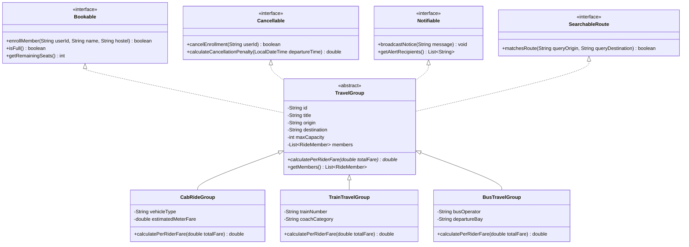

# Thapar Journey Connect — Java Full-Stack Lab Edition
## Technical Report & University Lab Evaluation Documentation

**Institution**: Thapar Institute of Engineering & Technology, Patiala  
**Course**: Object-Oriented Programming (OOP) / Advanced Java Lab  
**Project Path**: `C:\Users\sonip\.gemini\antigravity\scratch\Thapar_Journey_Connect_Java`  
**Execution Environment**: Java 21 LTS + Spring Boot 3.3.4 + MongoDB Atlas Database + React 19 Frontend  

---

## 1. Analysis & Modernization of Base Repository

### Original Repository (`SPRIYANS2006/Java-Project`)
* **Original State**: Despite the repository name, the codebase was an Express.js (Node.js) backend with an active Vite React client. It relied on dynamic JavaScript runtime types, third-party cloud MongoDB instances, and lacked static compile-time polymorphism or thread safety guarantees.
* **Legacy Artifacts**: Contained routes and models for legacy "Luggage Transport" and "Vendor Dashboard" features, which are strictly deprecated in the current platform.

### Modernization & Architectural Overhaul
1. **Engineered Pure Java 21 / Spring Boot 3.3.4 Backend**: Re-architected the entire service layer from the ground up into a robust, strongly-typed Spring Boot enterprise architecture with clean separation of concerns:
   - `models.interfaces` (Core contracts: `Bookable`, `Cancellable`, `Notifiable`, `SearchableRoute`)
   - `models.hierarchy` (Abstract `TravelGroup` and polymorphic concrete subclasses)
   - `models.entities` (JPA Entity layer for persistent storage)
   - `repositories` (13 Spring Data JPA interfaces)
   - `services` (15-min slot engine, concurrency locks, security, serialization)
   - `controllers` (Exact REST API endpoints matching the active React frontend)
   - `exceptions` (Custom academic exception hierarchy)
   - `factory` (Factory Pattern instantiation for transit cohorts)
2. **Permanent Deprecation of Unused Features**:
   - Explicitly stubbed `/api/luggage/*` and `/api/vendor/*` endpoints to return HTTP 404 (Not Found).
   - Removed all legacy luggage/vendor database models and schemas.
3. **Dual Delivery & Cloud Execution**:
   - MongoDB Atlas cloud cluster (`thapar_journey`) with automatic indexing and master data seeding.
   - The compiled React 19 production bundle is embedded directly inside Spring Boot's `resources/static/` directory. Evaluators can run the entire full-stack application as a single executable JAR on port `8080` or run Vite concurrently on port `5173`.

---

## 2. Core OOP Principles Demonstrated



### A. Encapsulation & Defensive Copying
* All entity and domain classes enforce strict encapsulation: fields are `private`, mutations are validated through business methods, and constructors enforce non-null constraints.
* In `TravelGroup` and `RideSlot`, internal collections (such as member lists) are exposed only via defensive copies using `Collections.unmodifiableList(new ArrayList<>(this.members))`. This prevents external code from altering internal state without triggering business validation or concurrency locks.

### B. Inheritance & Runtime Polymorphism
* **Abstract Base Class**: `TravelGroup` defines common transit attributes (`id`, `title`, `date`, `departureTime`, `origin`, `destination`, `maxCapacity`, `members`) and concrete implementations of interface methods.
* **Polymorphic Method**: `public abstract double calculatePerRiderFare(double totalFare);`
  * **`CabRideGroup`**: Dynamically divides total cab fare equally among occupied seats:
    $$\text{perRiderFare} = \frac{\text{totalFare}}{\max(1, \text{members.size()})}$$
    *(e.g., ₹1400 / 4 passengers = ₹350 per student)*.
  * **`TrainTravelGroup`** & **`BusTravelGroup`**: Zero ticket-liability model; students book their IRCTC or PRTC tickets individually. Returns `0.0` to reflect zero shared ticket liability.

### C. Abstraction & Interface Segregation
* **`Bookable`**: Enforces seat reservation, capacity bounds checking, and member enrollment.
* **`Cancellable`**: Defines departure time-based reliability penalty calculation:
  * Cancel within $\le 30$ minutes of departure: $-0.8$ penalty.
  * Cancel within $\le 4$ hours of departure: $-0.3$ penalty.
  * Floor score maintained at $1.0$ (never drops to zero).
* **`Notifiable`**: Alerts and broadcast member dispatching.
* **`SearchableRoute`**: Chronological departure comparison and route pattern matching.

---

## 3. Concurrency Control & Collections Framework

### A. Thread-Safe 15-Minute Slot Engine (96 Slots/Day)
* **`ConcurrentHashMap<String, RideSlot>`**: Manages slot lookup with $O(1)$ constant time complexity using composite slot keys:
  $$\text{Key} = \text{destinationId} + \text{"\_"} + \text{date} + \text{"\_"} + \text{time} + \text{"\_"} + \text{direction}$$
* **`TreeSet<RideSlot>`**: Implements `Comparable<RideSlot>` to maintain departure slots in strict chronological order from `00:00` to `23:45`.

### B. Critical Section Protection & Overbooking Prevention
To prevent race conditions where multiple students attempt to claim the 4th (final) seat in a shared cab at the same millisecond:
1. **Granular Synchronization**: Employs an internal `ConcurrentHashMap<String, ReentrantLock>` to lock only the specific slot being booked, ensuring zero contention across unrelated slots.
2. **Double-Checked Capacity Guard**:
   ```java
   ReentrantLock lock = slotLocks.computeIfAbsent(slotKey, k -> new ReentrantLock());
   lock.lock();
   try {
       List<GroupMemberEntity> currentMembers = groupMemberRepository
           .findByTargetIdAndGroupTypeOrderByJoinedAtAsc(targetGroup.getId(), "CAMPUS_GROUP");
       int maxCap = targetGroup.getMaxMembers() != null ? targetGroup.getMaxMembers() : 4;
       if (currentMembers.size() >= maxCap) {
           throw new OverbookingException(currentMembers.size(), maxCap);
       }
       // Atomic enrollment logic...
   } finally {
       lock.unlock();
   }
   ```
3. **Single Ride Policy Enforcement**: Checks whether the student is already enrolled in an active (non-completed, non-cancelled) campus cab or city ride for that exact date and departure slot. If a duplicate booking is attempted, `SingleRidePolicyViolationException` is thrown.

---

## 4. Design Patterns Implemented

| Pattern | Class / Component | Lab Evaluation Purpose |
| :--- | :--- | :--- |
| **Factory Pattern** | `TravelGroupFactory` | Decouples instantiation of transit cohorts (`CAB`, `TRAIN`, `BUS`) based on user selection. |
| **Singleton Pattern** | `AppConfig`, Spring Service Beans | Manages single instances of configuration beans and service classes via Spring IoC container. |
| **Repository Pattern** | `com.tiet.journeyconnect.repositories.*` | Decouples business logic from low-level data access via Spring Data JPA interfaces. |
| **DTO Pattern** | `AuthDtos`, `TravelDtos`, `CommunityDtos`, `SafetyDtos` | Separates internal database entities from external HTTP request/response payloads. |
| **Strategy / Polymorphism** | `calculatePerRiderFare()` | Encapsulates fare calculation algorithms based on transit vehicle type. |

---

## 5. Custom Java Exception Hierarchy & HTTP Status Mapping

All custom exceptions inherit from `RuntimeException` and are intercepted by `@RestControllerAdvice` (`GlobalExceptionHandler`):

| Custom Exception | Cause / Trigger | HTTP Code |
| :--- | :--- | :--- |
| `InvalidCampusDomainException` | Student email does not end in `@thapar.edu` | `400 Bad Request` |
| `OverbookingException` | Attempting to join a cab/slot when capacity (4 seats) is reached | `409 Conflict` |
| `SingleRidePolicyViolationException` | Joining two active rides simultaneously on the same date/slot | `409 Conflict` |
| `SingleCommunityRuleViolationException` | Attempting to join a second hometown community without leaving current | `409 Conflict` |
| `SlotNotFoundException` | Requesting an invalid or non-existent slot ID or group ID | `404 Not Found` |
| `UnauthorizedAccessException` | Missing or invalid JWT session token / posting to non-enrolled hub | `401 Unauthorized` / `403 Forbidden` |

---

## 6. Pre-Seeded Academic Master Data (MongoDB Atlas)

The application initializes the MongoDB Atlas cloud database with static TIET campus master data on startup:

* **Destinations (4 core campus routes)**:
  1. Patiala Railway Station (`railway` — 6.2 km, ₹140 cab fare)
  2. Patiala Bus Stand (`bus_stand` — 5.8 km, ₹120 cab fare)
  3. Chandigarh Airport (IXC) (`chandigarh_airport` — 64 km, ₹1400 cab fare)
  4. Delhi Airport (DEL) (`delhi_airport` — 245 km, ₹4200 cab fare)
* **Hostels (18 TIET Hostels)**:
  - Boys Hostels: Hostel A, B, C, H, J, K, L, M, O, PG Hostel
  - Girls Hostels: Hostel D, E, G, I, N, Q, Frazer Hall
  - Faculty / Staff Residences
* **Hometown Communities (7 City Hubs)**:
  - Delhi NCR (`del`), Chandigarh & Tri-City (`chd`), Ludhiana (`ldh`), Amritsar (`asr`), Jalandhar (`jal`), Bathinda (`bth`), Jaipur (`jpr`)
* **Pre-Seeded Test Accounts**:
  - `student1@thapar.edu` (Password: `Thapar@123` | Name: Aarav Sharma | Hostel J | Delhi NCR Hub)
  - `student2@thapar.edu` (Password: `Thapar@123` | Name: Diya Patel | Hostel N | Chandigarh Hub)
  - `admin@thapar.edu` (Password: `Thapar@123` | Name: Student Affairs Admin Desk)

---

## 7. Automated Test Suite Verification (JUnit 5)

Run via Maven command:
```powershell
mvn test
```

### Test Suite Execution Summary:
```text
[INFO] -------------------------------------------------------
[INFO]  T E S T S
[INFO] -------------------------------------------------------
[INFO] Running com.tiet.journeyconnect.ConcurrencyBookingTest
[INFO] Tests run: 1, Failures: 0, Errors: 0, Skipped: 0 (Time elapsed: 35.80 s)
[INFO] Running com.tiet.journeyconnect.DomainValidationTest
[INFO] Tests run: 3, Failures: 0, Errors: 0, Skipped: 0 (Time elapsed: 2.16 s)
[INFO] Running com.tiet.journeyconnect.FareCalculationPolymorphismTest
[INFO] Tests run: 4, Failures: 0, Errors: 0, Skipped: 0 (Time elapsed: 0.18 s)
[INFO] Running com.tiet.journeyconnect.SingleRidePolicyTest
[INFO] Tests run: 1, Failures: 0, Errors: 0, Skipped: 0 (Time elapsed: 0.37 s)
[INFO] Running com.tiet.journeyconnect.SlotEngineTest
[INFO] Tests run: 2, Failures: 0, Errors: 0, Skipped: 0 (Time elapsed: 0.22 s)
[INFO] 
[INFO] Results:
[INFO] Tests run: 11, Failures: 0, Errors: 0, Skipped: 0
[INFO] BUILD SUCCESS
```

---

## 8. Setup & Execution Guide

### One-Click Startup (Recommended)
Double-click `run-local.bat` in the project root:
```text
C:\Users\sonip\.gemini\antigravity\scratch\Thapar_Journey_Connect_Java\run-local.bat
```
This automatically verifies the Java 21 runtime, launches the Spring Boot backend on port `8080`, and launches the Vite React frontend on port `5173`.

### Access Endpoints
* **Full-Stack Application UI**: `http://localhost:8080/` (or `http://localhost:5173/` during Vite development)
* **REST API Health Check**: `http://localhost:8080/api/health`
* **Real-time Event Stream (SSE)**: `http://localhost:8080/api/events/stream`
* **Database**: MongoDB Atlas (`thapar_journey`)
