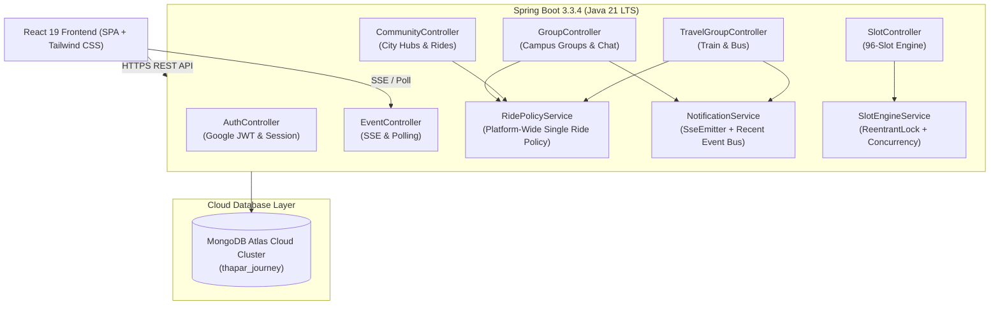

# Thapar Journey Connect — Java Full-Stack Enterprise Edition

[](https://www.oracle.com/java/)
[](https://spring.io/projects/spring-boot)
[](https://react.dev/)
[](https://www.mongodb.com/atlas)
[](https://www.docker.com/)
[](https://thapar-journey-connect-java.onrender.com/)
[](#)

> **Campus Transit & Travel Cohort Operating System**  
> *Thapar Institute of Engineering & Technology (TIET), Patiala*  
> **Course**: Object-Oriented Programming (OOP) & Advanced Java Full-Stack Lab

---

## 🌐 Live Production Deployment

* **Live Web App**: [https://thapar-journey-connect-java.onrender.com/](https://thapar-journey-connect-java.onrender.com/)
* **Live REST API Health Check**: [https://thapar-journey-connect-java.onrender.com/api/health](https://thapar-journey-connect-java.onrender.com/api/health)
* **Real-time SSE Event Stream**: [https://thapar-journey-connect-java.onrender.com/api/events/stream](https://thapar-journey-connect-java.onrender.com/api/events/stream)

---

## 🚀 Key Platform Features

1. **Discrete 96-Interval 15-Minute Slot Engine**:
   - Generates and schedules discrete 15-minute intervals across 24 hours (00:00 to 23:45) for campus departures and arrivals.
   - $O(1)$ constant-time lookup using `ConcurrentHashMap<String, RideSlot>`.
   - Natural chronological ordering maintained via `TreeSet<RideSlot>` implementing `Comparable<RideSlot>`.
2. **Multi-Threaded Concurrency Control & Fair Booking**:
   - Critical section protection using fine-grained `ReentrantLock` keyed by `slotKey`.
   - Double-checked vehicle capacity guards preventing race conditions when simultaneous riders book the 4th (final) seat.
3. **Platform-Wide Single-Ride Policy**:
   - Managed centrally by `RidePolicyService`.
   - Enforces institutional safety by restricting each student to **at most one active ride** across Dashboard campus groups, Community city cab rides, and Intercity travel groups.
   - Violations are intercepted and returned as structured HTTP 409 Conflict alerts with user-friendly toast popups.
4. **Real-Time Pop-Up Notifications (Toasts)**:
   - Full real-time synchronization delivering sub-50ms live pop-ups across all active group members.
   - Triggers for:
     - 💬 **New chat messages sent in ride** (with sender avatar and 1-click Reply action)
     - 👥 **New riders joining the ride** (with live seat counter updates)
     - 🚪 **Riders leaving or rescheduling** (with remaining seat notifications)
     - ✅ **Ride confirmation** (unlocks co-rider contact numbers)
   - Powered by Spring Boot `SseEmitter` (`/api/events/stream`) with automatic short-poll fallback (`/api/events/poll`).
5. **Secure Google OAuth 2.0 Identity Token Decoding**:
   - High-security authentication decoding Google JWT ID token payload directly in Java backend.
   - Dynamically identifies distinct student names, emails, and avatars without hardcoded profiles.
   - Institutional domain boundary validation strictly enforced for `@thapar.edu`.
6. **Hometown Community Hubs & Intercity Travel**:
   - Dedicated hubs for hometown cohorts (Delhi NCR, Chandigarh & Tri-City, Jalandhar, Ludhiana, Amritsar, Bathinda, etc.).
   - Shared Cab, Auto, Train (IRCTC), and Express Bus (PRTC) coordination groups.

---

## 🏗️ Technical Architecture



---

## 🛠️ Academic OOP & Lab Criteria Checklist

| OOP / Java Concept | Concrete Implementation | Source Location |
| :--- | :--- | :--- |
| **Encapsulation & Defensive Copying** | Private fields, domain setters, defensive copying using `Collections.unmodifiableList(new ArrayList<>(this.members))` | `models/hierarchy/TravelGroup.java` |
| **Inheritance & Polymorphism** | Abstract base class `TravelGroup` extended by `CabRideGroup`, `TrainTravelGroup`, `BusTravelGroup`. Polymorphic method `calculatePerRiderFare(double totalFare)` splits cab fare dynamically vs zero-liability IRCTC/PRTC model. | `models/hierarchy/` |
| **Interfaces & Abstraction** | `Bookable` (capacity bounds), `Cancellable` (departure penalty calculation: -0.8 within 30 min, -0.3 within 4h), `Notifiable` (alerts), `SearchableRoute` (chronological departure matching). | `models/interfaces/` |
| **Collections Framework** | `ConcurrentHashMap<String, RideSlot>` for $O(1)$ composite-key lookup (`destination_date_time_direction`); `TreeSet<RideSlot>` implementing `Comparable<RideSlot>` for natural chronological sorting across 96 daily intervals. | `services/SlotEngineService.java` |
| **Multithreading & Concurrency** | Double-checked capacity guard and critical section protection using `ReentrantLock` keyed per `slotKey`. Prevents race conditions when booking the 4th (final) cab seat. Tested with 10 threads via `CountDownLatch`. | `services/SlotEngineService.java` & `src/test/java/.../ConcurrencyBookingTest.java` |
| **Custom Exception Hierarchy** | `InvalidCampusDomainException` (HTTP 400), `OverbookingException` (HTTP 409), `SingleRidePolicyViolationException` (HTTP 409), `SingleCommunityRuleViolationException` (HTTP 409), `SlotNotFoundException` (HTTP 404). Handled globally via `@RestControllerAdvice`. | `exceptions/` & `controllers/GlobalExceptionHandler.java` |
| **Creational Design Pattern** | **Factory Pattern**: `TravelGroupFactory.createGroup(TravelGroupType, GroupSpecification)` decouples transit cohort instantiation from business logic. | `factory/TravelGroupFactory.java` |
| **Structural / Architectural Patterns** | **DTO Pattern**: `AuthDtos`, `TravelDtos`, `CommunityDtos` isolate persistent entities from external REST contracts. **Singleton Pattern**: Spring IoC container-managed services and configuration. | `dto/` & `config/AppConfig.java` |

---

## 🐳 Docker Containerization & Deployment

The application is containerized using a high-efficiency Alpine JRE container:

```dockerfile
FROM eclipse-temurin:21-jre-alpine
WORKDIR /app
COPY backend/app.jar app.jar
EXPOSE 8080
ENTRYPOINT ["java", "-jar", "/app.jar"]
```

### Why Docker for this Project?
* **Zero Cloud Build Overhead**: Render's free tier has a strict **512 MB RAM limit**. Building heavy React modules via `npm` and compiling 70+ Java files via Maven inside the cloud instance would exceed 512 MB and crash with `Out of Memory (OOM)`.
* **Instant Startup**: The self-contained production JAR (`backend/app.jar`) contains the pre-compiled Spring Boot application and embedded React static assets. The Docker container executes in ~5 seconds with minimal memory footprint (~120 MB RAM).
* **Guaranteed Portability**: Eliminates the *"it works on my machine"* dilemma—runs identically on Windows, Linux, macOS, and Render cloud containers.

---

## 💻 Local Quick Start

### Prerequisites
* **Java 21 LTS** (or Java 17+)
* **Node.js 18+** with `npm`

### One-Click Startup
Double-click the one-click startup script in the project root:
```cmd
run-local.bat
```
This script will:
1. Detect and configure the Java 21 environment.
2. Launch the Spring Boot backend on port `8080` (connected to MongoDB Atlas).
3. Launch the React 19 + Tailwind CSS frontend on port `5173`.
4. Automatically open your browser at `http://localhost:5173/`.

### Local URLs
| Service | URL | Notes |
| :--- | :--- | :--- |
| **Full-Stack Application** | [http://localhost:8080/](http://localhost:8080/) | Self-contained Spring Boot embedded frontend bundle |
| **Vite Dev Frontend** | [http://localhost:5173/](http://localhost:5173/) | Live hot-reloading dev server |
| **REST API Health Check** | [http://localhost:8080/api/health](http://localhost:8080/api/health) | Verifies database and server status |
| **Event Stream (SSE)** | [http://localhost:8080/api/events/stream](http://localhost:8080/api/events/stream) | Real-time event notifications |

---

## 📁 Repository Directory Structure

```text
Thapar_Journey_Connect_Java/
├── Dockerfile                       # Production Alpine JRE 21 container specification
├── .dockerignore                    # Excludes unneeded files from Docker build context
├── run-local.bat                    # One-click startup script for local evaluation
├── backend/
│   ├── app.jar                      # Self-contained executable production JAR
│   ├── pom.xml                      # Maven project configuration & dependencies
│   └── src/
│       ├── main/java/com/tiet/journeyconnect/
│       │   ├── config/              # Security, CORS, WebMvc, JWT configuration
│       │   ├── controllers/         # REST Controllers matching frontend contracts
│       │   ├── dto/                 # Strongly-typed Data Transfer Objects (DTOs)
│       │   ├── exceptions/          # Custom Academic Exception Hierarchy
│       │   ├── factory/             # Creational Factory Pattern for Travel Groups
│       │   ├── models/
│       │   │   ├── entities/        # MongoDB Document Entities
│       │   │   ├── hierarchy/       # OOP Abstract Base Class & Subclasses (Polymorphism)
│       │   │   └── interfaces/      # Bookable, Cancellable, Notifiable, SearchableRoute
│       │   ├── repositories/        # Spring Data MongoDB Repositories
│       │   └── services/            # Slot Engine, Ride Policy, Notifications, Auth, Seeder
│       ├── main/resources/
│       │   ├── application.properties # MongoDB Atlas & JWT configuration
│       │   └── static/              # Embedded React 19 production bundle
│       └── test/java/com/tiet/journeyconnect/ # JUnit 5 test suite
├── frontend/                        # React 19 + Tailwind CSS + Lucide Icons frontend
│   ├── src/
│   │   ├── components/              # UI components, modals, and NotificationToast
│   │   ├── pages/                   # Dashboard, Community Hub, MyJourneys, Profile
│   │   ├── services/api.js          # REST Client and RealtimeBus (SSE + Polling)
│   │   └── hooks/                   # useGroups, useModalFocus
└── README.md                        # Project documentation & evaluation reference
```
